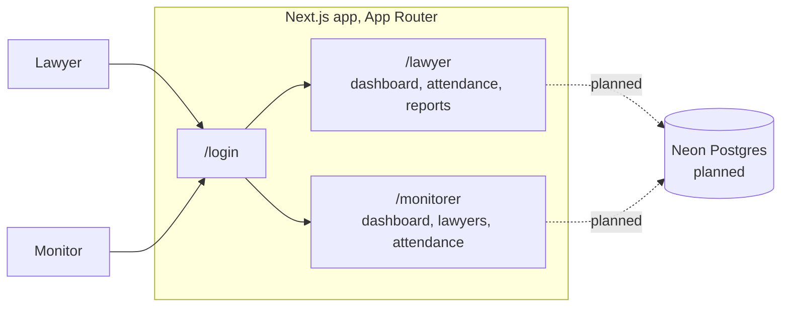

# ULAS: Attendance Tracking for IBP Makati

**A web app for the Integrated Bar of the Philippines (IBP) Makati Chapter that tracks lawyers' attendance and work hours, with separate workspaces for lawyers and the staff who monitor them.**


> **Status:** early development. The page structure and the first UI screens are in place. The database, authentication, and attendance logic are not built yet. The [roadmap](#roadmap) below lists what's done and what's planned.

<!-- Screenshot placeholder: add a screenshot of the login or monitor dashboard at docs/images/dashboard.png, then uncomment:

-->

## Features

### Built so far

- Landing page and navigation bar
- Login screen (UI only; not connected to authentication yet)
- Monitor dashboard layout with a sidebar for Dashboard, Lawyers, Attendance, and Reports
- Route structure for both roles:
  - **Lawyer:** `/lawyer/dashboard`, `/lawyer/attendance`, `/lawyer/reports`
  - **Monitor:** `/monitorer/dashboard`, `/monitorer/lawyers`, `/monitorer/attendance`

### Roadmap

- [x] Next.js App Router project with Tailwind CSS 4 and TypeScript
- [x] Role-based page structure (lawyer, monitor)
- [x] Login and dashboard UI shells
- [ ] Neon Postgres database and schema (lawyers, attendance records)
- [ ] Authentication and role-based access
- [ ] Time-in / time-out logging for lawyers
- [ ] Lawyer roster management for monitors
- [ ] Attendance and work-hour reports

## Tech stack

| Area | Tools |
| --- | --- |
| Framework | Next.js 16 (App Router), React 19, TypeScript |
| Styling | Tailwind CSS 4, lucide-react icons, Geist font |
| Database | Neon serverless Postgres (planned; the project is initialized for Neon but not connected yet) |
| Tooling | ESLint (`eslint-config-next`) |

## Architecture

The planned design: one Next.js app serves both roles, with route groups per role and a Neon Postgres database behind server-side data access. Dashed lines are not built yet.



## My role

I'm the sole developer: I set up the project, defined the role-based route structure, and built the current UI screens.

## Getting started

### Prerequisites

- Node.js 20.9 or newer and npm

### Install and run

```bash
git clone https://github.com/klacom/ibp-makati-ulas.git
cd ibp-makati-ulas
npm install
npm run dev        # http://localhost:3000
```

Other scripts: `npm run build`, `npm start`, and `npm run lint`.

No environment variables are needed yet. Database credentials will be added with the Neon integration.

## Project structure

```text
ibp-makati-ulas/
├── app/
│   ├── page.tsx              # landing page
│   ├── login/                # login screen
│   ├── lawyer/               # dashboard, attendance, reports
│   ├── monitorer/            # dashboard, lawyers, attendance, reports
│   ├── layout.tsx
│   └── globals.css
├── components/ui/            # navbar, sidebar, button
├── next.config.ts
└── package.json
```

## Team

- **Klarenz Cobie O. Manrique** ([@klacom](https://github.com/klacom))

## Other projects

- [EcoPin](https://github.com/klacom/ecopin_backend_node): crowdsourced environmental reporting and cleanup dispatch for Pasig City (capstone)
- [Pithos](https://github.com/klacom/pithos): 3D asset marketplace with PayMongo checkout
